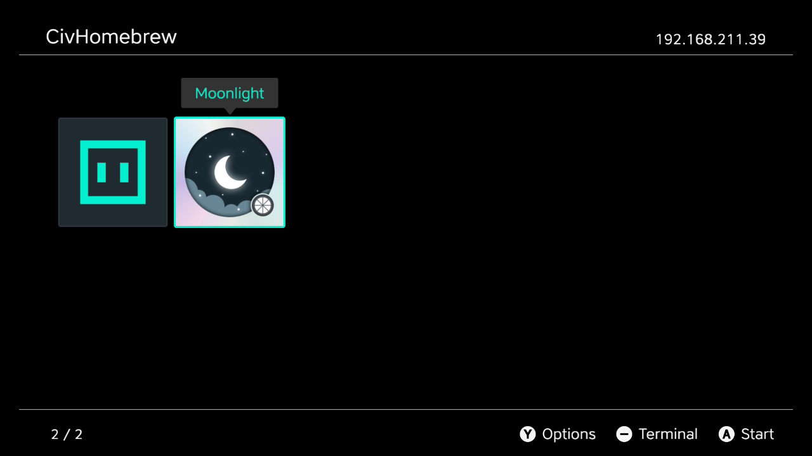
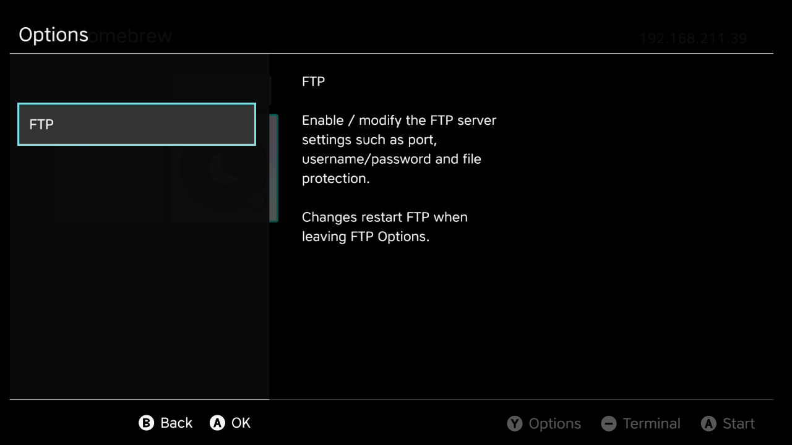
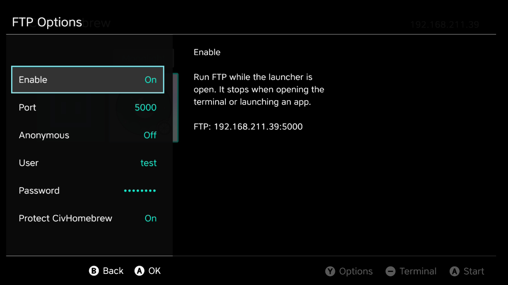

# CivHomebrew

A homebrew launcher for Nintendo Switch and Switch 2, powered by
[Gezine’s CivSwitch](https://github.com/Gezine/CivSwitch). Browse your apps, install
`.civapp` packages over FTP, and launch them straight from your console.
A built-in terminal keeps the original JavaScript payload workflow close at hand.

| App library | Options | FTP settings |
| :---: | :---: | :---: |
| [](docs/images/launcher.jpg) | [](docs/images/options.jpg) | [](docs/images/ftp-settings.jpg) |

*Screenshots from a console; apps shown are installed separately. Click to enlarge.*

## Getting started

You’ll need a working [CivSwitch setup](https://github.com/Gezine/CivSwitch#workflow)
using the **Switch 1 edition of Civilization VII, physical cartridge version 1.0.0**,
and a computer on the same network. CivHomebrew runs CivSwitch JavaScript apps;
`.nro` homebrew is not supported.

### Prepare

1. Install **Git** and **Python 3.10+** on your computer. Permanent installation
   and building from source also need **Node.js 22+ with npm**.
2. Open **Terminal** on macOS or Linux, or **PowerShell** on Windows.
3. Copy and paste these commands one line at a time, pressing **Enter** after each:

   ```sh
   git clone https://github.com/XITRIX/CivHomebrew.git
   cd CivHomebrew
   ```

   The first command downloads the project; the second opens its folder in the
   terminal. Keep this window open and use it for the commands below.

Replace `SWITCH_IP` in each command with your console’s IP address, for example
`192.168.1.100`. Then choose one of the following installation methods.

### Try before installing

Leave Gezine’s Remote JS Loader waiting for a payload (TCP **9026**), then run:

```sh
python3 tools/payload_menu.py menu SWITCH_IP
```

This builds and uploads CivHomebrew for the current session without replacing the
boot trigger. Keep the PC terminal open. To return to Gezine’s loader, press
**−** in CivHomebrew, then **+** in its terminal. Apps you install are saved.

### Permanent installation — recommended

Already have Gezine’s persistent boot trigger (`XSTRIG.Civ7Save`) installed?
Leave Gezine’s loader or CivHomebrew idle and run:

```sh
python3 tools/install_homebrew.py SWITCH_IP
```

The installer builds CivHomebrew, verifies backups on the PC and console, and
replaces only the existing trigger. Apps, settings and other saves are preserved.
Keep the PC’s `backups/` folder.

Restart Civilization VII and open **Load Game**. CivHomebrew now starts directly,
with no PC required. Hold **−** while opening Load Game for the recovery terminal.
To restore Gezine’s original trigger:

```sh
python3 tools/install_homebrew.py SWITCH_IP --restore
```

Restart the game afterward. See [installation and recovery](docs/boot-installation.md)
for backup details.

## Install apps over FTP

1. In CivHomebrew, press **Y → FTP**, set **Enable** to **On**, and note the
   address and port (default **5000**). Press **B** to save and leave FTP settings.
2. Connect with an FTP client such as FileZilla: use the console’s IP, that port,
   **plain FTP**, passive mode and binary transfers. Use anonymous login unless
   you configured a username and password in FTP settings.
3. Open **`Install civapp`** and upload your `.civapp` file. Wait for installation
   to finish; the app appears in the library. Select it and press **A** to launch.

FTP runs while the launcher is open and stops in the terminal or a running app.
Use a trusted local network and trusted app packages. To update an app, upload
its new `.civapp`; keep your packages on the PC for reinstalling.

Use **Y Options → Check for updates** for CivHomebrew itself. Supported apps have
**X Menu → Check app updates**. Once a newer version is found, the action is saved
as **Update available** and rechecks before offering installation. Launcher-only
updates reload automatically; core changes show a full-restart instruction.
See [release publishing and component versions](docs/system-updates.md).

## Build from source

Complete [Prepare](#prepare) above, including installing **Node.js 22+ with npm**,
then run these commands in the same terminal:

```sh
npm run build
npm run pack:hello
python3 tools/package_payload.py --inspect dist/hello.civapp
npm test
```

No npm or pip dependencies are required. Output is in `dist/`:

- `payload-menu.js` — the launcher’s boot payload; `menu` uploads it with staging
  when needed.
- `core.civupdate` and `launcher.civupdate` — system component updates.
- `civhomebrew-release.json` — complete target component set for GitHub releases.
- `hello.civapp` — a small sample app, ready to install over FTP.

Use either installation method above to run your build. For a browser preview,
run `npm run preview` and open [localhost:8001](http://127.0.0.1:8001/?demo=1).
Optional `npm run test:ui` checks require Google Chrome.

[Full usage guide](docs/usage.md) · [Architecture and updates](docs/architecture.md)

To publish update-ready artifacts, use the manual **Release CivHomebrew** workflow
with a version input. It preserves unchanged component versions and publishes the
complete release snapshot. See [release workflow](docs/releases.md).

## .civapp packager

Bundle your CivSwitch app’s scripts, metadata and optional icon into one `.civapp`
file for sharing and FTP installation. The standalone packager works in any
project with **Python 3.10+**.

**[Read the full packager documentation →](docs/packager.md)**


## Shared native renderer

The native Launcher, Hello, Moonlight and Doom now pin **CivHomebrew-SDK 1.3.5**.
Kit Checks and SW2NES require the same installed SDK and borrow its shared owner. Renderer
fixes are maintained in that standalone library and consumed as identical,
checksum-pinned release bundles. CivHomebrew owns the terminal/Launcher adapter.
See [shared renderer integration](docs/shared-native-ui.md) for builds, version
updates and the required Civ VII restart. The extraction is host-validated;
earlier device qualification remains attached to its original builds.

## Native UI history

An opt-in [NanoVG / Vulkan launcher prototype](docs/nanovg-prototype.md) reuses
the DOM layout, caches geometry and atlases, and draws with GPU compute. It has
separate browser and host Vulkan comparisons and bounded Switch 2 qualification.
The [shared native terminal trial](docs/nanovg-terminal.md) keeps one display
across launcher/terminal switches. Both remain opt-in; the installed terminal is
unchanged.

## Credits

- [XITRIX](https://github.com/XITRIX) — CivHomebrew.
- [Gezine](https://github.com/Gezine/CivSwitch) — CivSwitch, its native bridge,
  original loader and sender. Upstream code retains its [MIT license](third_party/CivSwitch-LICENSE.txt).
- The [upstream contributors](https://github.com/Gezine/CivSwitch#credits) whose
  work made CivSwitch possible, and everyone helping test CivHomebrew.

See [provenance](docs/provenance.md) for implementation sources and attribution.
